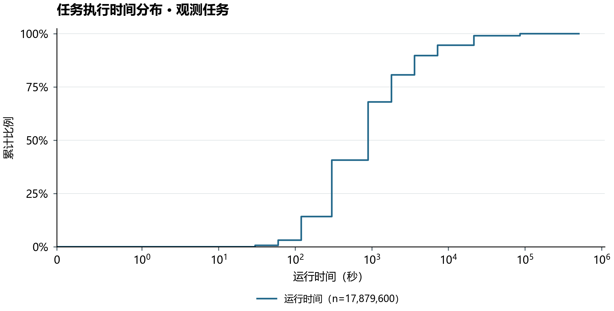
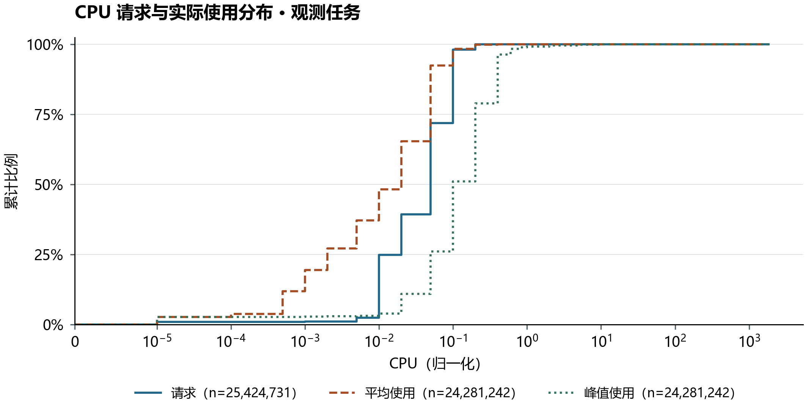
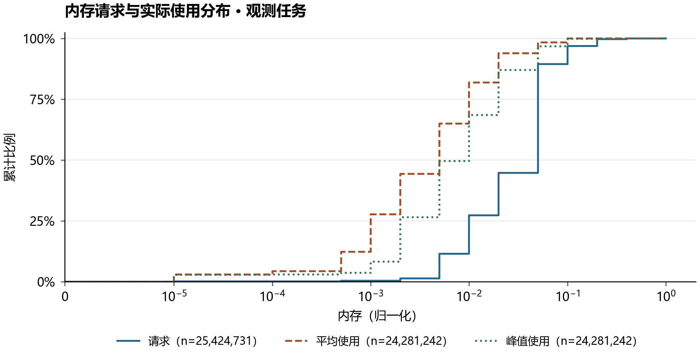
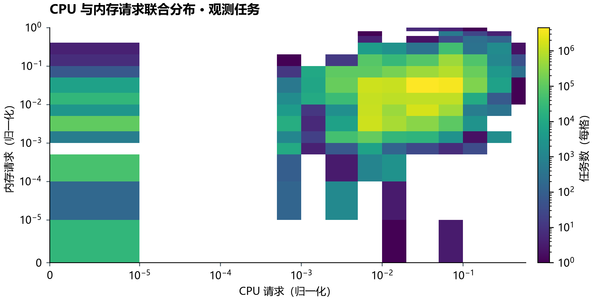
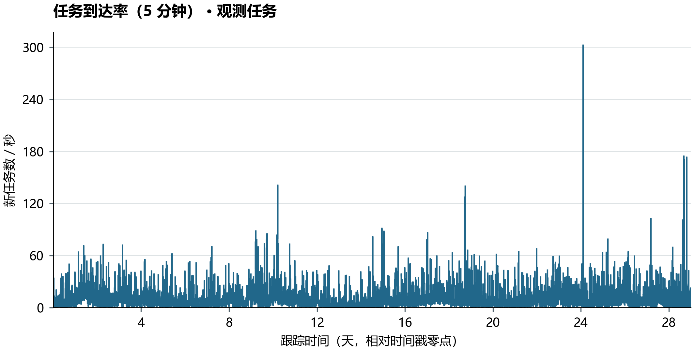
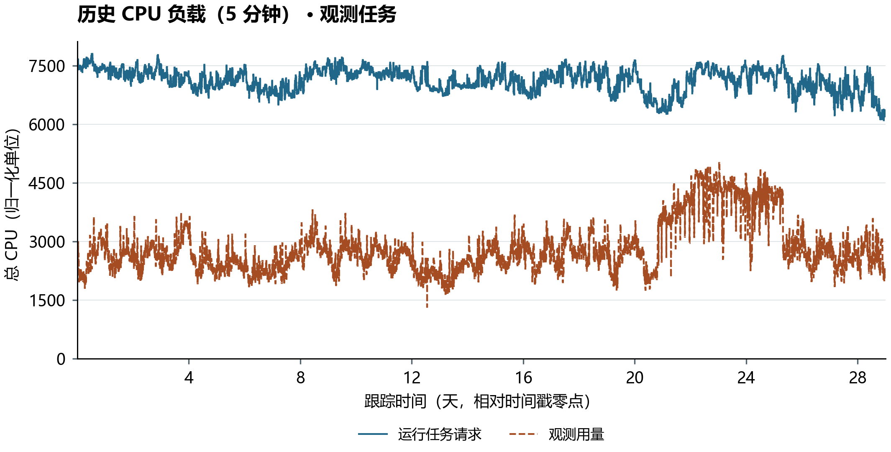
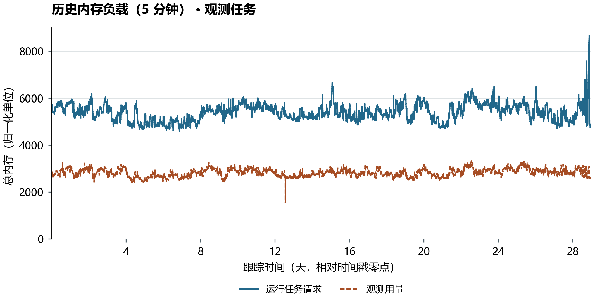
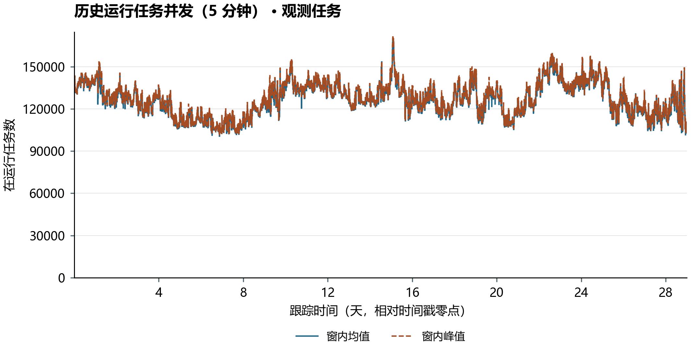

# Google Cluster Trace 2011 工作负载统计

## 数据来源与覆盖

数据来自 Google 官方 `gs://clusterdata-2011-2/` 的 v2.1 发布版，覆盖 2011 年 5 月一个 Borg cell 的约 29 天。原始时间戳是整数微秒。`600,000,000 µs` 对应 `2011-05-01 19:00 EDT`，`0` 用于窗口前状态。官方 Schema 用 `2^63−1` 表示窗口后事件，发布文件末尾还实际出现了 5 条 `2^64−1` 合成运行更新。分析保留这些记录，将两种表示统一为窗口后标记，避免纳入有限时间轴。按当地时间比较日夜时，需在该锚点上加上 `t−600 s`。窗前在运行的任务可用于恢复期初负载，窗前提交记录不计入窗内到达。来源为 [Google 发布说明](https://github.com/google/cluster-data/blob/master/ClusterData2011_2.md)及 [v2.1 Schema](https://drive.google.com/file/d/0B5g07T_gRDg9Z0lsSTEtTWtpOW8/view?resourcekey=0-cozD56gA4fUDdrkHnLJSrQ&usp=sharing)。

本地清单列出 **2,007 个官方对象（44.130 GB）**，其中 **2,007 个已校验（44.130 GB，41.099 GiB）**。已校验压缩字节占清单的 100.000%。清单所列对象均已获得完整校验。 [下载清单](download_manifest.csv)

统计输入固定为分析启动时通过 SHA-256 校验的连续分片前缀。从第 0 分片开始，到首个缺片处停止；后续补齐的对象在重跑时进入统计。

| 表 | 官方对象 | 本地已校验 | 已校验大小 | 本次参与统计分片 |
| --- | --- | --- | --- | --- |
| `task_events` | 500 | 500 | 1.624 GB | 500 |
| `task_usage` | 500 | 500 | 42.120 GB | 500 |
| `job_events` | 500 | 500 | 0.087 GB | 500 |
| `machine_events` | 1 | 1 | 347.2 kB | 1 |
| `machine_attributes` | 1 | 1 | 0.144 GB | 1 |
| `task_constraints` | 500 | 500 | 0.154 GB | 500 |
| `metadata` | 5 | 5 | 527.8 kB | — |

| 统计窗口 | 开始时间戳（秒） | 截止时间戳（秒，开区间） | 覆盖小时 | 2011 年 EDT |
| --- | --- | --- | --- | --- |
| 任务事件 | 600 | 2,506,199.603 | 696 | 05-01 19:00:00 至 05-30 18:59:59 |
| 用量观测 | 600 | 2,506,200 | 696 | 05-01 19:00:00 至 05-30 19:00:00 |
| 两者交集 | 600 | 2,506,199.603 | 696 | 05-01 19:00:00 至 05-30 18:59:59 |

下载覆盖率按压缩字节计，分析覆盖按分片和时间计。报告中的 `—` 表示该统计无可用数据。逐任务分布采用 DuckDB t-digest 近似分位数，结果可能随扫描顺序略有变化。时间窗指标和 VM 双维覆盖使用精确分位数或逐条计数。源数据见 [主要统计](workload_statistics.csv)及 [分窗明细](plot_data/timeseries.csv)。

## 字段及单位

| 表 | 主要相关字段 | 含义与边界 |
| --- | --- | --- |
| `task_events` | `timestamp`、`missing info`、`job ID`、`task index`、`machine ID`、`event type`、`scheduling class`、`priority`、CPU 与 RAM 请求、异机约束 | `(job ID, task index)` 唯一识别任务。`SUBMIT` 表示进入可调度状态，`SCHEDULE` 是分配到机器的时间，实际代码开始时间可能略晚。`FINISH` 是正常结束，其他终止和资源更新见下文。 |
| `task_usage` | 测量区间起止、任务与机器标识、平均 CPU 速率、最大 CPU 速率、canonical 内存、最大内存、随机 1 秒 CPU 样本 | 测量通常按 5 分钟窗口提供，部分窗口更短。Canonical 内存包括适用的页缓存，另列容器分配内存和缓存字段。最大 CPU 的子容器聚合方式由标志字段说明。随机 1 秒值可用于波动分析。 |
| `machine_events` | `timestamp`、`machine ID`、`event type`、`platform ID`、CPU 与内存容量 | `ADD/REMOVE/UPDATE` 表示加入、退出、资源更新。平台 ID 是匿名的微架构／芯片组标识，同一平台机器仍可具有不同核心数、频率和内存速度。 |
| `machine_attributes` | 时间、机器标识、属性名、属性值、删除标志 | 机器属性为时变键值对，可供核对放置限制和硬件差异。匿名值的物理意义需要外部对照。 |
| `job_events` | 时间、`missing info`、`job ID`、事件类型、调度类别、匿名用户及作业名称 | 用于核对作业口径和事件边界。哈希名称可判断相等，任务依赖及应用语义的可见性有限。 |
| `task_constraints` | 时间、任务标识、比较运算符、属性名和值 | 与机器属性联用可辨认部分硬件／软件专属任务。 |

CPU 请求与机器容量的原始维度是核心数，CPU 用量的原始维度是核心秒／秒；内存的原始维度是字节。公开值对每种资源独立缩放，使该资源的最大单机容量为 `1.0`，并将结果舍入。原始分母未公开。归一化 CPU `0.1` 应读作最大单机 CPU 容量的约十分之一，换算到核心数需外部标定；归一化内存同理。真实使用可高于请求，例如任务使用了当时闲置 CPU。作业与任务标识是匿名数字，优先级是有序编码，调度类别衡量相对延迟敏感度。这些字段及 `missing info` 号段具有独立含义。字段顺序以发布版的 `schema.csv` 为准。来源为 [v2.1 Schema](https://drive.google.com/file/d/0B5g07T_gRDg9Z0lsSTEtTWtpOW8/view?resourcekey=0-cozD56gA4fUDdrkHnLJSrQ&usp=sharing)。

## 生命周期、筛选与缺失

事件代码 `0 SUBMIT`、`1 SCHEDULE`、`2 EVICT`、`3 FAIL`、`4 FINISH`、`5 KILL`、`6 LOST`、`7 UPDATE_PENDING`、`8 UPDATE_RUNNING`。`EVICT/FAIL/KILL` 后可再次 `SUBMIT`；到达统计对任务计首次有效提交，退出统计需同时区分最终状态与曾发生过的终止，后者可重叠。`missing info` 表示发布者补出的记录或缺失场景，空值表示该行没有此标记。Google 官方估计调度事件记录缺失少于 0.05%，用量测量缺失少于 1%。这些是发布者对全量数据的估计，本地数据质量需按清单和实际统计重新说明。来源为 [Google 已知异常](https://github.com/google/cluster-data/blob/master/ClusterData2011_2.md#known-anomalies-in-the-trace)及 [v2.1 Schema](https://drive.google.com/file/d/0B5g07T_gRDg9Z0lsSTEtTWtpOW8/view?resourcekey=0-cozD56gA4fUDdrkHnLJSrQ&usp=sharing)。

重建按任务键、时间戳、分片号和原始行序排序。一次完整尝试需要观测窗内的有效提交、调度与可判定终止，且运行区间为正；推断或 `LOST` 终止不计为完整。运行时长使用最后一次完整成功尝试的 `FINISH−SCHEDULE`。请求使用该次开始时的值，其他任务回退至首个可得请求。全局任务总数包括期初状态。

| 指标 | 数量 |
| --- | --- |
| 唯一任务 | 25,424,731 |
| 任务事件中的唯一 Job | 672,004 |
| 观测窗内完整生命周期任务 | 24,500,278 |
| 完整且成功的任务 | 17,879,600 |
| 有重复提交的任务 | 2,448,926 |
| 窗前已提交任务 | 144,339 |
| 无提交事件的任务 | 0 |
| 末状态仍待调度或运行的任务 | 104,627 |
| 含推断事件的任务 | 16,467 |
| 作业事件中的唯一 Job | 672,074 |
| 事件及放置约束预筛通过 | 136,126 |
| 完整落入用量观测窗的预筛任务 | 136,126 |
| 可用于独立 CPU 批处理研究的代理任务 | 87,269 |

| 退出原因 | 事件行 | 曾发生的任务 | 最终状态为该原因的任务 |
| --- | --- | --- | --- |
| 成功 | 18,217,975 | 17,889,741 | 17,808,187 |
| 失败 | 13,829,769 | 872,796 | 86,366 |
| 取消／其他不确定原因 | 10,349,680 | 7,572,636 | 7,411,326 |
| 驱逐 | 5,864,353 | 1,422,317 | 8,650 |
| 丢失终止 | 8,754 | 8,735 | 5,575 |

| 质量指标 | 比例 | 分母（任务或记录） |
| --- | --- | --- |
| CPU 请求缺失 | 0.000% | 25,424,731 |
| 内存请求缺失 | 0.000% | 25,424,731 |
| 调度类别缺失 | 0.000% | 25,424,731 |
| 优先级缺失 | 0.000% | 25,424,731 |
| 带补录标记的事件行 | 0.013% | 144,648,288 |
| 测量区间不可用 | 0.000% | 1,232,799,308 |
| 记录持续时间超过 300 秒 | 0.000% | 1,232,799,308 |
| 平均 CPU 缺失 | 0.000% | 1,232,799,308 |
| Canonical 内存缺失 | 0.000% | 1,232,799,308 |
| 最大 CPU 缺失 | 0.000% | 1,232,799,308 |
| 最大内存缺失 | 0.000% | 1,232,799,308 |

清洗按官方 `schema.csv` 读取，标识和时间保留整数，空字段保留缺失，剔除非有限或负的资源值，合法的零用量保留。总体使用分布按观测到的任务分别计算时长加权用量，重复尝试可贡献用量；批处理代理用同机器且与成功区间重叠的用量记录， CPU 与内存分别去重覆盖时间，覆盖时长均至少为运行时间的 90%，且 CPU 累积工作量为正。预筛要求观测中只有一个任务的作业、单次完整成功、调度类别 0–1、运行期固定的正 CPU／内存请求、无推断／重试／失效记录、无观测到的放置限制或异机约束。

| 调度类别 | 观测任务数 | 观测占比 | 代理任务数 | 代理占比 |
| --- | --- | --- | --- | --- |
| 0 | 21,304,623 | 83.795% | 14,229 | 16.305% |
| 1 | 3,431,473 | 13.497% | 73,040 | 83.695% |
| 2 | 612,045 | 2.407% | 0 | 0.000% |
| 3 | 76,590 | 0.301% | 0 | 0.000% |

| 优先级 | 观测任务数 | 观测占比 | 代理任务数 | 代理占比 |
| --- | --- | --- | --- | --- |
| 0 | 6,472,126 | 25.456% | 8,323 | 9.537% |
| 1 | 2,453,453 | 9.650% | 16,752 | 19.196% |
| 2 | 1,110,831 | 4.369% | 752 | 0.862% |
| 3 | 1,027 | 0.004% | 0 | 0.000% |
| 4 | 14,197,733 | 55.842% | 7,079 | 8.112% |
| 5 | 104 | 0.000% | 6 | 0.007% |
| 6 | 639,784 | 2.516% | 10,826 | 12.405% |
| 8 | 254,663 | 1.002% | 33,710 | 38.628% |
| 9 | 286,069 | 1.125% | 9,821 | 11.254% |
| 10 | 1,403 | 0.006% | 0 | 0.000% |
| 11 | 7,538 | 0.030% | 0 | 0.000% |

调度类别低表示更容忍等待，单任务作业且一次成功适合作为独立批处理的保守代理。数据包含提交时间和资源采样，应用级 DAG、服务／批处理标签、真实 Deadline、SLA 和任务级 GPU 用量均未公开。Google 文档指出，部分跨作业依赖只体现为作业在依赖满足后才变为可提交，依赖从未满足的作业也没有记录。因此，批处理代理仍可能包含依赖外部系统的任务，也会排除部分真实批任务。用于仿真时，应保留筛选条件、覆盖率和被排除任务的统计。来源为 [v2.1 Schema](https://drive.google.com/file/d/0B5g07T_gRDg9Z0lsSTEtTWtpOW8/view?resourcekey=0-cozD56gA4fUDdrkHnLJSrQ&usp=sharing)。

## 运行时间与资源需求

资源项为归一化数值，运行时长以秒计。任务级实际用量取其有效测量窗口的时长加权均值，任务级峰值取所见窗口的最大值。总体请求和总体用量分布的分母可不同，需求差值使用任务配对。

| 样本 | 指标 | n | 均值 | P50 | P75 | P90 | P95 | P99 | 最大 |
| --- | --- | --- | --- | --- | --- | --- | --- | --- | --- |
| 观测任务 | 运行时间（秒） | 17,879,600 | 1,706.874 | 449.727 | 1,282.988 | 3,734.326 | 7,706.22 | 20,052.833 | 478,881.924 |
| 观测任务 | CPU 请求 | 25,424,731 | 0.033915 | 0.025215 | 0.0625 | 0.0625 | 0.06873 | 0.125 | 0.5 |
| 观测任务 | 任务平均 CPU 使用 | 24,281,242 | 0.018529 | 0.010897 | 0.026525 | 0.043784 | 0.060157 | 0.11992 | 0.57523 |
| 观测任务 | 任务峰值 CPU 使用 | 24,281,242 | 0.14925 | 0.096141 | 0.18349 | 0.26915 | 0.35739 | 0.87418 | 1,744 |
| 观测任务 | 内存请求 | 25,424,731 | 0.028494 | 0.025448 | 0.031812 | 0.05592 | 0.079711 | 0.14098 | 0.9551 |
| 观测任务 | 任务平均 canonical 内存 | 24,281,242 | 0.0063746 | 0.0026201 | 0.0076409 | 0.01567 | 0.022399 | 0.055812 | 0.77862 |
| 观测任务 | 任务峰值 canonical 内存 | 24,281,242 | 0.010336 | 0.0050691 | 0.012595 | 0.025531 | 0.035839 | 0.071203 | 0.8857 |
| 批处理代理 | 运行时间（秒） | 87,269 | 1,283.672 | 341.585 | 820.767 | 2,339.399 | 4,162.522 | 16,303.955 | 478,881.924 |
| 批处理代理 | CPU 请求 | 87,269 | 0.031677 | 0.024898 | 0.0625 | 0.0625 | 0.0625 | 0.0625 | 0.375 |
| 批处理代理 | 任务平均 CPU 使用 | 87,269 | 0.0099028 | 0.0034103 | 0.016372 | 0.027861 | 0.041222 | 0.048202 | 0.30513 |
| 批处理代理 | 任务峰值 CPU 使用 | 87,269 | 0.079279 | 0.06261 | 0.10988 | 0.15783 | 0.20583 | 0.28009 | 4.039 |
| 批处理代理 | 内存请求 | 87,269 | 0.016764 | 0.012151 | 0.020278 | 0.0318 | 0.0636 | 0.09167 | 0.6367 |
| 批处理代理 | 任务平均 canonical 内存 | 87,269 | 0.0044393 | 0.0013721 | 0.0032884 | 0.0056026 | 0.0213 | 0.048623 | 0.32811 |
| 批处理代理 | 任务峰值 canonical 内存 | 87,269 | 0.0068673 | 0.002523 | 0.0052587 | 0.0092 | 0.02904 | 0.06934 | 0.5439 |

| 样本 | 短于 60 秒 | 至少一小时 |
| --- | --- | --- |
| 观测任务 | 3.062% | 10.268% |
| 批处理代理 | 2.041% | 5.815% |

| 样本 | 资源 | 配对指标 | n | 均值 | P50 | P90 | P95 | P99 |
| --- | --- | --- | --- | --- | --- | --- | --- | --- |
| 观测任务 | CPU | 用量 − 请求 | 24,281,242 | -0.014965 | -0.00867 | 0.016434 | 0.030393 | 0.077733 |
| 观测任务 | CPU | 用量／请求（正请求） | 24,076,040 | 0.91989 | 0.42189 | 2.143 | 3.118 | 5.86 |
| 观测任务 | 内存 | 用量 − 请求 | 24,281,242 | -0.020597 | -0.015804 | -0.0025653 | -0.0015683 | 0.00072756 |
| 观测任务 | 内存 | 用量／请求（正请求） | 24,281,239 | 0.29297 | 0.17856 | 0.53994 | 0.71934 | 1.083 |
| 批处理代理 | CPU | 用量 − 请求 | 87,269 | -0.021774 | -0.014944 | -0.00097854 | 0.0030843 | 0.014302 |
| 批处理代理 | CPU | 用量／请求（正请求） | 87,269 | 0.42659 | 0.14712 | 0.9102 | 1.191 | 2.279 |
| 批处理代理 | 内存 | 用量 − 请求 | 87,269 | -0.012325 | -0.0088673 | -0.0012644 | -0.0010033 | 0.00028085 |
| 批处理代理 | 内存 | 用量／请求（正请求） | 87,269 | 0.27611 | 0.24767 | 0.59779 | 0.68491 | 1.126 |

| 样本 | CPU／内存请求 Pearson r | CPU／内存用量 Pearson r | CPU 请求 ≤ 0.02 且内存请求 ≥ 0.1 |
| --- | --- | --- | --- |
| 观测任务 | 0.30135 | 0.49994 | 0.463% |
| 批处理代理 | 0.38978 | 0.70418 | 0.007% |

| 调度类别 | CPU 请求 n | CPU 请求 P50 | CPU 请求 P95 | CPU 用量 n | 平均 CPU 用量 P50 | 平均 CPU 用量 P95 |
| --- | --- | --- | --- | --- | --- | --- |
| 0 | 21,304,623 | 0.025056 | 0.064201 | 20,291,329 | 0.011447 | 0.055967 |
| 1 | 3,431,473 | 0.025364 | 0.11359 | 3,352,005 | 0.0089143 | 0.10496 |
| 2 | 612,045 | 0.03125 | 0.125 | 563,730 | 0.001952 | 0.075621 |
| 3 | 76,590 | 0.0625 | 0.2407 | 74,178 | 0.0086453 | 0.069012 |

观测任务 CPU 请求 P50 为 0.025215，P99 为 0.125。这两个分位数分别说明典型请求和尾部容量压力。较大的归一化请求可用于挑选大 VM 候选，任务的实际并行线程数仍需其他资料确认。低 CPU／高内存任务占比以指定阈值计算，VM 规格需要按两维联合覆盖核验。

峰值／均值按同一任务配对。这个比值描述任务从有记录窗口观察到的波动，单窗口任务无法提供跨窗口变化证据。

| 样本 | 时间波动指标 | n | P50 | P90 | P95 | P99 |
| --- | --- | --- | --- | --- | --- | --- |
| 观测任务 | CPU 峰值／平均用量 | 23,631,972 | 11.085 | 57.727 | 90.055 | 241.658 |
| 观测任务 | 内存峰值／平均用量 | 23,602,270 | 1.712 | 3.753 | 5.738 | 16.75 |
| 观测任务 | 每任务用量记录数 | 24,281,242 | 6 | 28 | 54 | 642 |
| 批处理代理 | CPU 峰值／平均用量 | 87,269 | 17.47 | 129.196 | 196.698 | 471.938 |
| 批处理代理 | 内存峰值／平均用量 | 87,230 | 1.653 | 2.781 | 3.487 | 8.353 |

观测任务的 CPU 窗口峰值最大为 1,744，超过最大单机归一化容量 1。该字段可能包含子容器最大值的加总，极端记录应按聚合标志和原始区间复核。容量推导直接使用请求分位数及区间平均用量，峰值尾部在原统计和分布图中保留。

分布图用已汇总的原始分箱上界绘制累计比例，分别标注各条曲线的样本量。横轴在零附近线性展开以保留零值，随后为对数尺度。联合分布颜色表示每格任务数，色标采用对数刻度。

## 到达、历史运行负载与并发

首次提交按 1、5、15、60 分钟取整分窗，到达率单位为新任务数／秒，跨窗比较时看各自的 P95/P99 和峰值。日夜的当地时间口径及样本数以统计说明为准。大桶会平滑短时峰值。

| 样本 | 每窗分钟 | 每窗平均新任务数 | 窗数 | 平均率 | P95 | P99 | 峰值率 | 零到达窗比例 |
| --- | --- | --- | --- | --- | --- | --- | --- | --- |
| 观测任务 | 1 | 605.383 | 41,759 | 10.0897 | 40.2333 | 105.6737 | 1,505.3167 | 0.244% |
| 观测任务 | 5 | 3,026.829 | 8,351 | 10.0894 | 31.2250 | 53.2517 | 302.3833 | 0.012% |
| 观测任务 | 15 | 9,080.402 | 2,783 | 10.0893 | 23.8512 | 35.8608 | 108.8756 | 0.000% |
| 观测任务 | 60 | 36,324.919 | 695 | 10.0903 | 19.5086 | 25.6224 | 46.7031 | 0.000% |
| 批处理代理 | 1 | 2.09 | 41,759 | 0.0348 | 0.1000 | 0.1667 | 0.4167 | 24.524% |
| 批处理代理 | 5 | 10.45 | 8,351 | 0.0348 | 0.0700 | 0.0900 | 0.1567 | 0.251% |
| 批处理代理 | 15 | 31.356 | 2,783 | 0.0348 | 0.0610 | 0.0756 | 0.1244 | 0.000% |
| 批处理代理 | 60 | 125.495 | 695 | 0.0349 | 0.0508 | 0.0589 | 0.0817 | 0.000% |

| 口径 | 5 分钟窗指标 | 有效窗 | 均值 | P95 | P99 | 最大 |
| --- | --- | --- | --- | --- | --- | --- |
| 观测任务 | CPU 请求 | 8,351 | 7,131.145 | 7,538.308 | 7,651.914 | 7,808.411 |
| 观测任务 | CPU 实际用量 | 8,352 | 2,818.308 | 4,326.543 | 4,688.429 | 5,013.44 |
| 观测任务 | 内存请求 | 8,351 | 5,398.968 | 5,970.185 | 6,322.446 | 8,666.299 |
| 观测任务 | 内存实际用量 | 8,352 | 2,821.259 | 3,091.973 | 3,187.618 | 3,326.514 |
| 观测任务 | 并发均值 | 8,351 | 126,404.429 | 144,972.142 | 152,356.923 | 170,320.559 |
| 观测任务 | 窗内峰值并发 | 8,351 | 127,680.55 | 146,478 | 153,725.5 | 171,231 |
| 批处理代理 | CPU 请求 | 8,351 | 1.515 | 2.319 | 2.724 | 3.402 |
| 批处理代理 | CPU 实际用量 | 8,351 | 0.25064 | 0.4268 | 0.59325 | 1.059 |
| 批处理代理 | 内存请求 | 8,351 | 0.93871 | 1.46 | 1.77 | 2.466 |
| 批处理代理 | 内存实际用量 | 8,351 | 0.15171 | 0.2468 | 0.34268 | 1.127 |
| 批处理代理 | 并发均值 | 8,351 | 44.715 | 64.349 | 74.327 | 100.858 |
| 批处理代理 | 窗内峰值并发 | 8,351 | 48.1 | 68 | 79 | 108 |
| 代理任务提交即运行 | CPU 请求 | 8,351 | 1.515 | 2.32 | 2.721 | 3.4 |
| 代理任务提交即运行 | 内存请求 | 8,351 | 0.93871 | 1.459 | 1.771 | 2.465 |
| 代理任务提交即运行 | 并发均值 | 8,351 | 44.715 | 64.386 | 74.364 | 100.813 |
| 代理任务提交即运行 | 窗内峰值并发 | 8,351 | 48.079 | 68 | 79 | 108 |

| 观测任务指标 | 07:00–19:00 EDT 平均 | 窗数 | 19:00–07:00 EDT 平均 | 窗数 |
| --- | --- | --- | --- | --- |
| 到达率（个／秒） | 9.303 | 4,175 | 10.876 | 4,176 |
| CPU 请求 | 7,121.293 | 4,175 | 7,140.994 | 4,176 |
| CPU 实际用量 | 2,897.696 | 4,176 | 2,738.919 | 4,176 |
| 内存请求 | 5,413.813 | 4,175 | 5,384.126 | 4,176 |
| 内存实际用量 | 2,842.015 | 4,176 | 2,800.503 | 4,176 |
| 并发均值 | 126,023.15 | 4,175 | 126,785.616 | 4,176 |

按小时的均值及样本数见 [当地小时统计](plot_data/diurnal.csv)。日夜差异为单个 cell 的描述统计，应结合分日曲线核验重复性。

在至少 24 个有效 5 分钟窗的当地小时中，以下时段的跨日均值最低和最高。

| 观测指标 | 低值小时（EDT） | 均值 | 窗数 | 高值小时（EDT） | 均值 | 窗数 |
| --- | --- | --- | --- | --- | --- | --- |
| 到达率 | 09:00 | 7.801 | 348 | 19:00 | 16.449 | 348 |
| CPU 用量 | 02:00 | 2,628.43 | 348 | 19:00 | 3,029.954 | 348 |
| 内存用量 | 21:00 | 2,771.487 | 348 | 06:00 | 2,872.181 | 348 |

运行请求在事件改变处更新，并按窗内运行时间加权；缺少请求的任务不贡献该维占用。观测总用量将每条窗口均值乘以与统计窗的重叠秒数后累加，再除以窗宽。并发峰值取窗内事件扫线的最大运行数。请求和实际用量均用归一化资源单位表示。提交即运行序列只重排历史成功时长及请求，估计的是资源压力，未加入仿真中的排队及容量限制。

观测任务的 1 分钟峰值到达率约为该粒度平均值的 149.19 倍。这个比值用于标定短时突发，不宜用 1 小时平均替代。

下图按 5 分钟汇总。运行请求曲线来自事件流重建的运行区间；观测用量曲线来自 `task_usage` 采样窗口。对于没有观测覆盖的窗口，图中留空。运行请求与用量的缺失口径或观测覆盖有差异时，应使用同时配对的指标比较二者。

三种时间序列各有含义。① 历史负载使用 Google 既有的实际分配和运行窗口；② 提交即运行属于反事实，可把每个候选任务的历史运行时长／资源轮廓平移至实际提交时刻，重新做区间叠加；③ 仿真算法的负载由新开始时刻、Cloudlet→VM、VM→Host 和模拟完成时刻共同决定。① 用于对照真实到达与历史资源压力，② 可作为容量规划的估计基线，③ 用于评价新策略。

## 机器资源与可建模结论

| 机器指标 | 数量 |
| --- | --- |
| 机器数 | 12,583 |
| 期初机器数 | 12,477 |
| ADD 记录 | 21,443 |
| REMOVE 记录 | 8,957 |
| UPDATE 记录 | 7,380 |
| 平台 ID 数 | 4 |
| 观测 CPU／内存容量组合数 | 10 |
| 属性记录数 | 10,748,566 |
| 有属性的机器数 | 12,583 |
| 属性名数 | 67 |
| 属性删除记录数 | 234 |

| 每台机器首个已知容量 | n | 均值 | P50 | P75 | P90 | P95 | P99 | 最大 |
| --- | --- | --- | --- | --- | --- | --- | --- | --- |
| CPU（归一化） | 12,583 | 0.52921 | 0.5 | 0.5 | 0.5 | 1 | 1 | 1 |
| 内存（归一化） | 12,583 | 0.46999 | 0.4995 | 0.4995 | 0.749 | 1 | 1 | 1 |

首次已知容量最常出现的组合以机器数排序。完整组合与匿名平台频数见 [主要统计](workload_statistics.csv)。

| CPU 容量 | 内存容量 | 机器数 |
| --- | --- | --- |
| 0.5 | 0.4995 | 6,728 |
| 0.5 | 0.2493 | 3,864 |
| 0.5 | 0.749 | 1,003 |
| 1.0 | 1.0 | 795 |
| 0.25 | 0.2498 | 126 |
| 0.5 | 0.1241 | 54 |

归一化机器容量能描述容量比例与异构程度。绝对核心数、GiB、MIPS、功率曲线与电网碳强度需另行选择或标定。在约束建模中，优先依据 CPU／内存联合需求检查可放置性，并使用运行时间和到达的真实分布保留调度压力。任务转换和容量参数见 [Cloudlet 转换方案](cloudlet_conversion_plan.md)及 [数据中心配置建议](datacenter_sizing_recommendations.md)。
