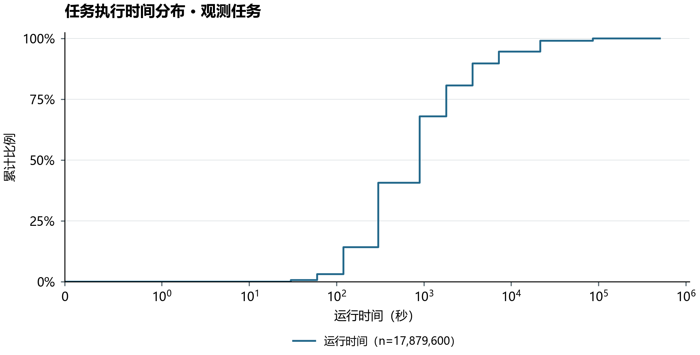
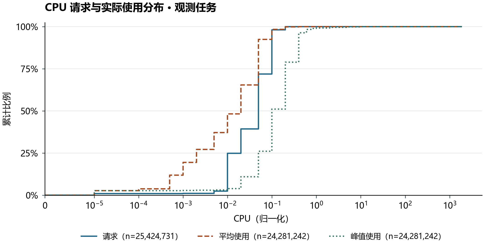
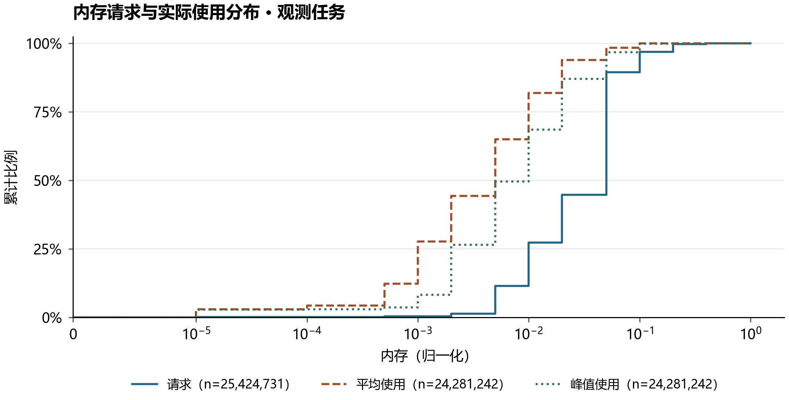
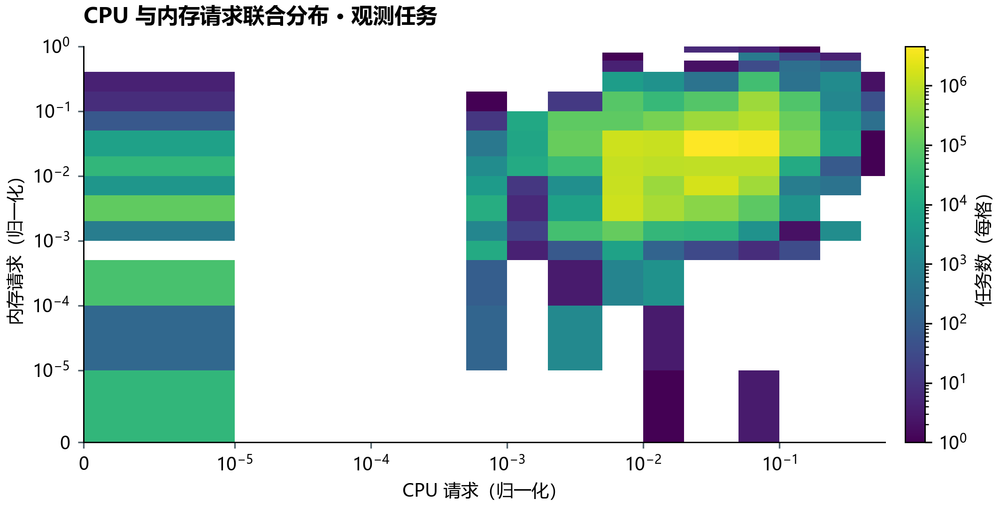
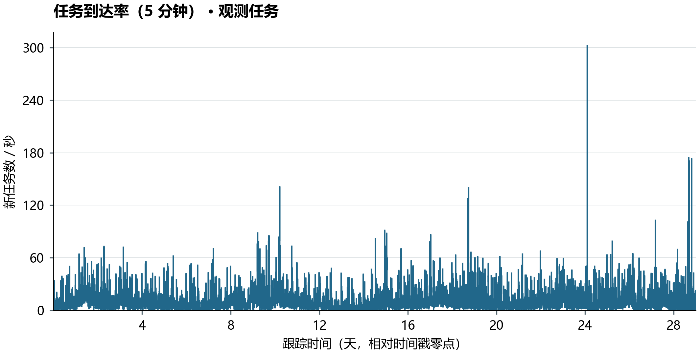
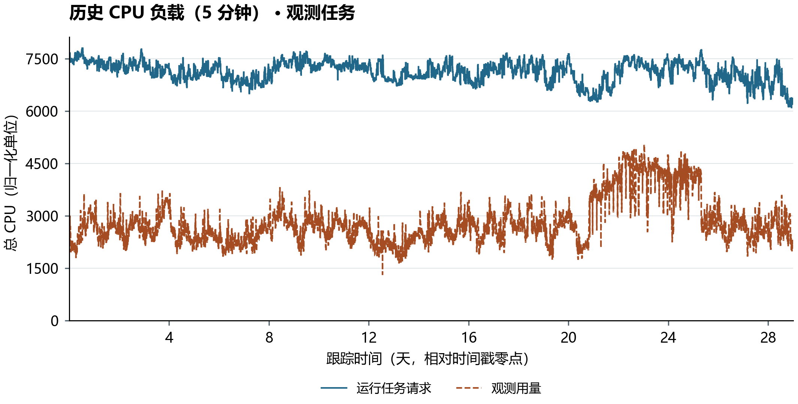
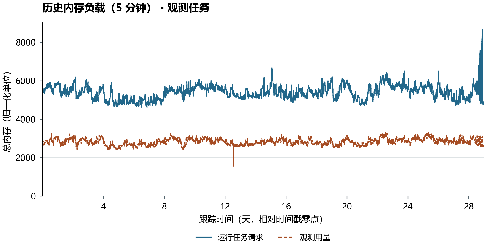
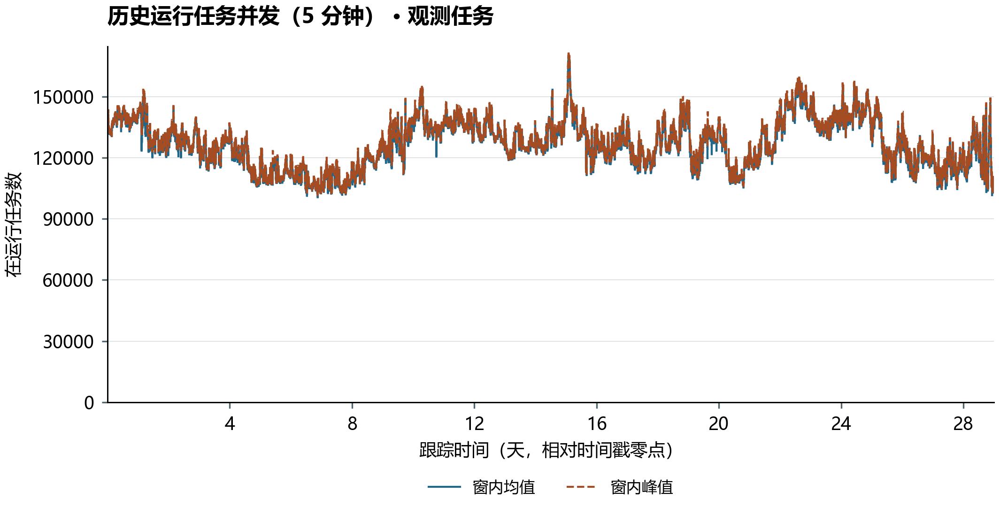

# Google Cluster Trace 2011 工作负载统计

## 数据来源与覆盖

数据来自 Google 官方 `gs://clusterdata-2011-2/` 的 v2.1 发布版，覆盖 2011 年 5 月一个 Borg cell 的约 29 天。原始时间戳是整数微秒。`600,000,000 µs` 对应 `2011-05-01 19:00 EDT`，`0` 用于窗口前状态。官方 Schema 用 `2^63−1` 表示窗口后事件，发布文件末尾还实际出现了 5 条 `2^64−1` 合成运行更新。分析保留这些记录，将两种表示统一为窗口后标记，避免纳入有限时间轴。按当地时间比较日夜时，需在该锚点上加上 `t−600 s`。窗前在运行的任务可用于恢复期初负载，窗前提交记录不计入窗内到达。来源为 [Google 发布说明](https://github.com/google/cluster-data/blob/master/ClusterData2011_2.md)及 [v2.1 Schema](https://drive.google.com/file/d/0B5g07T_gRDg9Z0lsSTEtTWtpOW8/view?resourcekey=0-cozD56gA4fUDdrkHnLJSrQ&usp=sharing)。

<!-- coverage -->

## 字段及单位

| 表 | 主要相关字段 | 含义与边界 |
| --- | --- | --- |
| `task_events` | `timestamp`、`missing info`、`job ID`、`task index`、`machine ID`、`event type`、`scheduling class`、`priority`、CPU 与 RAM 请求、异机约束 | `(job ID, task index)` 唯一识别任务。`SUBMIT` 表示进入可调度状态，`SCHEDULE` 是分配到机器的时间，实际代码开始时间可能略晚。`FINISH` 是正常结束，其他终止和资源更新见下文。 |
| `task_usage` | 测量区间起止、任务与机器标识、平均 CPU 速率、最大 CPU 速率、canonical 内存、最大内存、随机 1 秒 CPU 样本 | 测量通常按 5 分钟窗口提供，部分窗口更短。Canonical 内存包括适用的页缓存，另列容器分配内存和缓存字段。最大 CPU 的子容器聚合方式由标志字段说明。随机 1 秒值可用于波动分析。 |
| `machine_events` | `timestamp`、`machine ID`、`event type`、`platform ID`、CPU 与内存容量 | `ADD/REMOVE/UPDATE` 表示加入、退出、资源更新。平台 ID 是匿名的微架构／芯片组标识，同一平台机器仍可具有不同核心数、频率和内存速度。 |
| `machine_attributes` | 时间、机器标识、属性名、属性值、删除标志 | 机器属性为时变键值对，可供核对放置限制和硬件差异。匿名值的物理意义需要外部对照。 |
| `job_events` | 时间、`missing info`、`job ID`、事件类型、调度类别、匿名用户及作业名称 | 用于核对作业口径和事件边界。哈希名称可判断相等，任务依赖及应用语义的可见性有限。 |
| `task_constraints` | 时间、任务标识、比较运算符、属性名和值 | 与机器属性联用可辨认部分硬件／软件专属任务。 |

CPU 请求与机器容量的原始维度是核心数，CPU 用量的原始维度是核心秒／秒；内存的原始维度是字节。公开值对每种资源独立缩放，使该资源的最大单机容量为 `1.0`，并将结果舍入。原始分母未公开。归一化 CPU `0.1` 应读作最大单机 CPU 容量的约十分之一，换算到核心数需外部标定；归一化内存同理。真实使用可高于请求，例如任务使用了当时闲置 CPU。作业与任务标识是匿名数字，优先级是有序编码，调度类别衡量相对延迟敏感度。这些字段及 `missing info` 号段具有独立含义。字段顺序以发布版的 `schema.csv` 为准。来源为 [v2.1 Schema](https://drive.google.com/file/d/0B5g07T_gRDg9Z0lsSTEtTWtpOW8/view?resourcekey=0-cozD56gA4fUDdrkHnLJSrQ&usp=sharing)。

## 生命周期、筛选与缺失

事件代码 `0 SUBMIT`、`1 SCHEDULE`、`2 EVICT`、`3 FAIL`、`4 FINISH`、`5 KILL`、`6 LOST`、`7 UPDATE_PENDING`、`8 UPDATE_RUNNING`。`EVICT/FAIL/KILL` 后可再次 `SUBMIT`；到达统计对任务计首次有效提交，退出统计需同时区分最终状态与曾发生过的终止，后者可重叠。`missing info` 表示发布者补出的记录或缺失场景，空值表示该行没有此标记。Google 官方估计调度事件记录缺失少于 0.05%，用量测量缺失少于 1%。这些是发布者对全量数据的估计，本地数据质量需按清单和实际统计重新说明。来源为 [Google 已知异常](https://github.com/google/cluster-data/blob/master/ClusterData2011_2.md#known-anomalies-in-the-trace)及 [v2.1 Schema](https://drive.google.com/file/d/0B5g07T_gRDg9Z0lsSTEtTWtpOW8/view?resourcekey=0-cozD56gA4fUDdrkHnLJSrQ&usp=sharing)。

<!-- lifecycle methodology and counts -->

调度类别低表示更容忍等待，单任务作业且一次成功适合作为独立批处理的保守代理。数据包含提交时间和资源采样，应用级 DAG、服务／批处理标签、真实 Deadline、SLA 和任务级 GPU 用量均未公开。Google 文档指出，部分跨作业依赖只体现为作业在依赖满足后才变为可提交，依赖从未满足的作业也没有记录。因此，批处理代理仍可能包含依赖外部系统的任务，也会排除部分真实批任务。用于仿真时，应保留筛选条件、覆盖率和被排除任务的统计。来源为 [v2.1 Schema](https://drive.google.com/file/d/0B5g07T_gRDg9Z0lsSTEtTWtpOW8/view?resourcekey=0-cozD56gA4fUDdrkHnLJSrQ&usp=sharing)。

## 运行时间与资源需求

<!-- resource metrics and interpretation -->

分布图用已汇总的原始分箱上界绘制累计比例，分别标注各条曲线的样本量。横轴在零附近线性展开以保留零值，随后为对数尺度。联合分布颜色表示每格任务数，色标采用对数刻度。

## 到达、历史运行负载与并发

首次提交按 1、5、15、60 分钟取整分窗，到达率单位为新任务数／秒，跨窗比较时看各自的 P95/P99 和峰值。日夜的当地时间口径及样本数以统计说明为准。大桶会平滑短时峰值。

<!-- arrival, load and diurnal metrics -->

下图按 5 分钟汇总。运行请求曲线来自事件流重建的运行区间；观测用量曲线来自 `task_usage` 采样窗口。对于没有观测覆盖的窗口，图中留空。运行请求与用量的缺失口径或观测覆盖有差异时，应使用同时配对的指标比较二者。

三种时间序列各有含义。① 历史负载使用 Google 既有的实际分配和运行窗口；② 提交即运行属于反事实，可把每个候选任务的历史运行时长／资源轮廓平移至实际提交时刻，重新做区间叠加；③ 仿真算法的负载由新开始时刻、Cloudlet→VM、VM→Host 和模拟完成时刻共同决定。① 用于对照真实到达与历史资源压力，② 可作为容量规划的估计基线，③ 用于评价新策略。

## 机器资源与可建模结论

<!-- machine metrics and interpretation -->

归一化机器容量能描述容量比例与异构程度。绝对核心数、GiB、MIPS、功率曲线与电网碳强度需另行选择或标定。在约束建模中，优先依据 CPU／内存联合需求检查可放置性，并使用运行时间和到达的真实分布保留调度压力。任务转换和容量参数见 [Cloudlet 转换方案](cloudlet_conversion_plan.md)及 [数据中心配置建议](datacenter_sizing_recommendations.md)。
